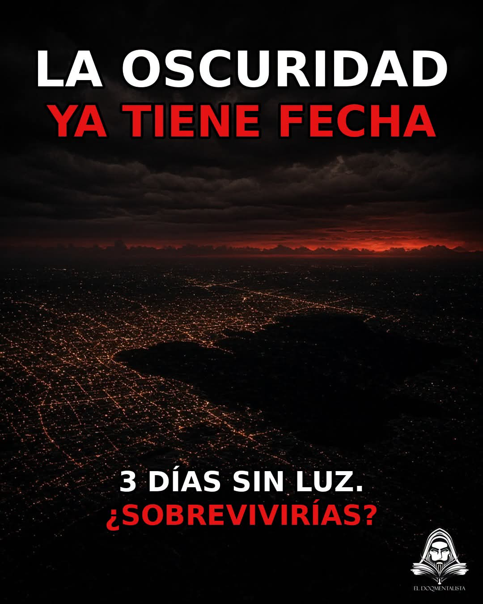

# Fórmula de imagen FB — 4 capas (El DoQmentalista)

**Origen:** análisis de la imagen del post FB «LA OSCURIDAD YA TIENE FECHA» (`1FHMNLAZGm`), 4–5 nov 2026.  
**Alcance:** estructura y diseño de la **pieza gráfica**. El caption va aparte.



---

## Las 4 capas (en la imagen)

| # | Capa | Qué hace |
|---|------|----------|
| **1** | **Título con hook** | Llama la atención. Misterio o afirmación fuerte. |
| **2** | **Imagen dramática** | Explica parte del tema sin depender del texto. |
| **3** | **Segundo hook corto** | Confirma y concreta el tema que se está tratando. |
| **4** | **Pregunta breve** | Reta y toca fibras clave. |

El orden es fijo y las cuatro capas van dentro de la imagen.

**Lógica:** 1 da curiosidad → 2 hace sentir el tema → 3 lo aterriza con un dato → 4 involucra al lector.

---

## Reglas de diseño

### 1. Blanco y luego rojo
En cada bloque de texto, la primera línea va en **blanco** y presenta el tema. La segunda va en **rojo** y trae la amenaza o la tensión.

| Bloque | Blanco (tema) | Rojo (tensión) |
|---|---|---|
| Arriba (capa 1) | `LA OSCURIDAD` | `YA TIENE FECHA` |
| Abajo (capas 3 + 4) | `3 DÍAS SIN LUZ.` | `¿SOBREVIVIRÍAS?` |

### 2. Arriba y abajo, con el centro libre
- **Tercio de arriba:** capa 1 (hook título).
- **Centro:** la imagen sola, sin texto encima.
- **Tercio de abajo:** capas 3 y 4 juntas, una debajo de la otra.

### 3. El rojo del texto sale de la imagen
El rojo de las letras es el mismo de un elemento de la imagen (en el ejemplo, el horizonte). Así texto e imagen se ven como una sola pieza. Si la imagen no tiene rojo, se le agrega un acento rojo: cielo, fuego, luz, ojos, etc.

### 4. Tipografía
- Sans-serif gruesa (bold / black), **siempre en mayúsculas**.
- Sombra o contorno negro para que se lea sobre fondo oscuro.
- Capa 1 grande, ocupando casi todo el ancho. Capas 3 y 4 más chicas, del mismo tamaño entre sí.
- Texto centrado.

### 5. Formato y logo
- **4:5 vertical — 1080 × 1350 px.**
- Logo El DoQmentalista **abajo a la derecha**, pequeño, sin competir con el texto.

### 6. Las frases se acortan de una capa a la siguiente
Cada capa usa menos palabras que la anterior, para que el golpe sea cada vez más corto.

| Capa | Ejemplo | Palabras |
|---|---|---|
| 1 | `LA OSCURIDAD YA TIENE FECHA` | 4–6 |
| 3 | `3 DÍAS SIN LUZ.` | 3–4 |
| 4 | `¿SOBREVIVIRÍAS?` | 1–3 |

### 7. Imagen dramática
- Paleta oscura, casi negra, con el acento rojo.
- Tiene que contar el tema **sin texto**. En el ejemplo, la ciudad con una zona ya apagada se lee como "apagón".
- Plano amplio o épico (aéreo, horizonte, escala grande).

---

## Ejemplo real (post oscuridad)

1. `LA OSCURIDAD` (blanco) / `YA TIENE FECHA` (rojo)
2. Ciudad nocturna aérea, horizonte rojo, una zona ya sin luz
3. `3 DÍAS SIN LUZ.` (blanco)
4. `¿SOBREVIVIRÍAS?` (rojo)

## Ejemplo de molde

1. `LOS EXTRATERRESTRES` (blanco) / `NOS INVADEN` (rojo)
2. [imagen dramática de invasión, cielo con acento rojo]
3. `QUIEREN NUESTROS CUERPOS.` (blanco)
4. `¿CÓMO SOBREVIVIRÍAS?` (rojo)

---

## Esqueleto

```text
┌──────────────────────────────┐
│  [1 HOOK TÍTULO — blanco]    │  ← tercio de arriba
│  [1 HOOK TÍTULO — rojo]      │
│                              │
│                              │
│    [2 IMAGEN DRAMÁTICA]      │  ← centro libre
│                              │
│                              │
│  [3 SEGUNDO HOOK — blanco]   │  ← tercio de abajo
│  [4 ¿PREGUNTA? — rojo]       │
│                       [logo] │
└──────────────────────────────┘
          1080 × 1350
```

## Brief por pieza

```text
1 HOOK TÍTULO
   Línea blanca:
   Línea roja:
2 IMAGEN DRAMÁTICA:
   Acento rojo en:
3 SEGUNDO HOOK (blanco):
4 PREGUNTA (rojo):
```

## Checklist antes de publicar

- [ ] Están las 4 capas, en orden.
- [ ] Cada bloque va blanco y luego rojo.
- [ ] El centro de la imagen está libre de texto.
- [ ] El rojo del texto coincide con un rojo de la imagen.
- [ ] Mayúsculas, sans-serif gruesa, con sombra o contorno.
- [ ] Cada capa usa menos palabras que la anterior.
- [ ] La imagen se entiende sin leer el texto.
- [ ] Formato 1080 × 1350 y logo abajo a la derecha.
